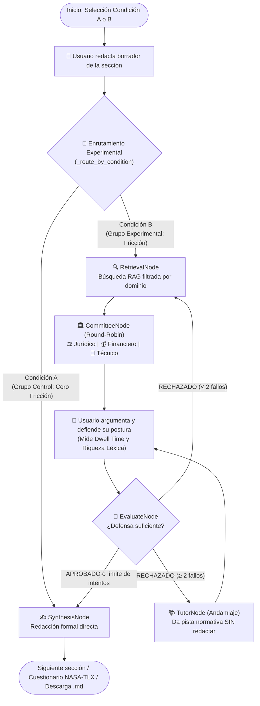

# Plataforma de Estructuración Contractual con Fricción Epistémica (`research_project_ai`)

**Proyecto de Investigación — Especialización en Inteligencia Artificial**  
**Tema:** Sistema Multiagente con Fricción Epistémica Estructurada (*Scaffolded AI Friction*) para Mitigar la Descarga Cognitiva en la Estructuración de Estudios Previos de Contratación Estatal en Colombia.  
**Estado del software:** 100 % Funcional (*Feature-Complete*) — Listo para recolección de datos piloto A/B.

---

## 1. Resumen Ejecutivo

El proyecto aborda el problema de la **descarga cognitiva (*cognitive offloading*)** y la delegación pasiva cuando los funcionarios públicos utilizan IA generativa convencional ("cero fricción") para redactar documentos precontractuales.

El sistema implementa un **Comité Evaluador Multiagente** sobre una base de conocimiento vectorial local (**6.606 fragmentos normativos**) que cuestiona los borradores del estructurador desde las perspectivas **Jurídica**, **Financiera** y **Técnica**, e incorpora un agente **Tutor de andamiaje pedagógico** cuando el usuario falla reiteradamente. Además, cuenta con un **modo experimental A/B** (sin fricción vs. con fricción), captura automática de **telemetría conductual en SQLite**, cuestionario **NASA-TLX integrado** y un **Dashboard de investigación** con exportación a CSV.

---

## 2. Arquitectura y Flujo del Grafo Multiagente (`LangGraph`)

Se implementó un grafo de estados tipado (`DialecticState`) con 5 nodos especializados y ciclo *Human-in-the-Loop*:



### Estructura del Repositorio

```text
research_project_ai/
├── agents/
│   ├── __init__.py         # Exports del paquete multiagente
│   ├── state.py            # Estado tipado (DialecticState, ContractConfig, condition)
│   ├── nodes.py            # 5 nodos: retrieval, committee, tutor, evaluate, synthesis
│   ├── dialectic.py        # Grafo LangGraph con enrutamiento condicional A/B y comité
│   └── mental_state.py     # Métricas de confianza por sección y por agente
├── config/
│   ├── prompts.py          # Prompts de los 3 auditores, tutor, evaluador y sintetizador
│   └── sections.py         # Definición de las secciones contractuales de Estudios Previos
├── data/                   # Corpus PDF organizado por subdirectorios de dominio
│   ├── juridico/           # Leyes 80, 1150, 1474, 1882, 2195, Decretos 1082 y 19
│   ├── financiero/         # Manuales CCE: Requisitos Habilitantes, Riesgos, Garantías, Sector
│   ├── tecnico/            # Guías MinTIC (MGGTI, MRAE, Seguridad Nube) y Acuerdo Marco CCE
│   └── general/            # Guías transversales de contratación estatal
├── telemetry/
│   ├── __init__.py
│   ├── storage.py          # Persistencia SQLite (tablas: sessions, events, nasa_tlx)
│   └── tracker.py          # Captura de dwell time, volumen/riqueza léxica, evaluaciones y TLX
├── frontend/
│   ├── app.py              # Aplicación principal de estructuración (:8501)
│   └── dashboard.py        # Dashboard de investigación, cruce A/B y exportación CSV (:8502)
└── ingest_data.py          # Pipeline RAG idempotente con separadores legales y metadato dominio
```

---

## 3. ¿Qué HAY Construido? (Componentes Operativos)

### 3.1 Comité Evaluador, Tutor y Modo Experimental A/B (`agents/`)
* **Comité Evaluador (3 Agentes Adversariales):** Cuestionan el borrador del estructurador desde las perspectivas **Jurídica**, **Financiera** y **Técnica**, planteando vacíos normativos y escenarios de riesgo sin redactarle la respuesta.
* **Andamiaje Pedagógico (`TutorNode`):** Si el estructurador falla 2 veces seguidas en una sección, el sistema desescala la fricción y activa al Tutor, quien entrega una pista conceptual basada en la norma antes del último intento.
* **Modo Experimental A/B Integrado:** Permite seleccionar al inicio de la sesión entre:
  * **Condición A (Sin fricción):** Pasa del borrador directamente al nodo sintetizador (`SynthesisNode`), simulando el uso de un asistente generativo tradicional.
  * **Condición B (Con fricción estructurada):** Ejecuta el ciclo completo de auditoría con el Comité y el Tutor antes de sintetizar.

### 3.2 Base de Conocimiento RAG Especializada (100 % Local)
* **Modelos Locales (`Ollama`):** Generación con `llama3` (8B) y vectorización con `nomic-embed-text`, garantizando privacidad total de la información pública sin depender de APIs comerciales externas.
* **Base Vectorial (`ChromaDB`):** **6.606 fragmentos (*chunks*)** indexados con separadores diseñados para técnica legislativa colombiana (`ARTÍCULO`, `PARÁGRAFO`, `CAPÍTULO`, `TÍTULO`, `chunk_size=800`, `chunk_overlap=150`) y sanitización automática de texto.
* **Filtrado por Dominio:** Cada agente consulta únicamente su subcarpeta normativa mediante metadatos (`dominio`: `juridico`, `financiero`, `tecnico`, `general`).

### 3.3 Flujo Multi-Sección de Estudios Previos (`frontend/app.py`)
El sistema guía al usuario por **4 secciones argumentativas** del Estudio Previo (para *Licitación Pública* y *Contratación Directa*) más una etapa de consolidación:
1. **Justificación de la Necesidad** (Auditores: Jurídico, Financiero, Técnico).
2. **Objeto y Especificaciones Técnicas** (Auditores: Jurídico, Financiero, Técnico).
3. **Valor Estimado y Apropiación Presupuestal** (Auditores: Financiero, Jurídico).
4. **Forma de Pago y Condiciones de Ejecución** (Auditores: Financiero, Jurídico, Técnico).
5. **Resumen, Cuestionario NASA-TLX y Descarga Consolidada (`.md`).**

### 3.4 Telemetría Cognitiva, NASA-TLX y Dashboard (`telemetry/`, `frontend/dashboard.py`)
Base de datos SQLite (`telemetry.db`) con tres tablas (`sessions`, `events`, `nasa_tlx`) que captura:
* **Métricas Conductuales y Léxicas (Objetivas):**
  * *Dwell Time* (segundos exactos de reflexión entre la pregunta del auditor y la respuesta del usuario).
  * *Volumen léxico* (cantidad de palabras en el borrador vs. en las defensas).
  * *Profundidad léxica* (*Type-Token Ratio*: proporción de vocabulario único sobre el total de palabras).
  * *Tasa de aprobación/rechazo desagregada por agente* y *activaciones del Tutor*.
  * *Tasa de completitud vs. abandono de sesión*.
* **Carga Mental Autopercibida (Subjetiva — NASA-TLX):**
  * 6 subescalas estándar (0–100) al cierre del documento: *Demanda mental, Demanda física, Demanda temporal, Rendimiento, Esfuerzo y Frustración*.
* **Dashboard del Investigador (`:8502`):**
  * Visualiza KPIs en tiempo real, promedios de las 6 subescalas NASA-TLX, **tabla comparativa automática Condición A vs. Condición B**, y botones para **descargar `sessions.csv`, `events.csv` y `nasa_tlx.csv`**.

---

## 4. ¿Qué NO HAY? (Delimitación del Alcance y Trabajo Futuro)

| Aspecto Acotado | Justificación Metodológica | Alternativa Implementada |
|---|---|---|
| **Medición neurofisiológica (EEG / biometría)** | La literatura base (Jiang et al., 2025) usa electroencefalografía en laboratorio, lo cual excede el alcance de una Especialización en IA. | **Proxies conductuales no intrusivos** (*Dwell Time*, volumen y riqueza léxica) combinados con el instrumento validado **NASA-TLX**. |
| **Secciones de plantilla fija (*boilerplate*) y tablas numéricas (UNSPSC, CDP, Sanciones)** | En un Estudio Previo real (~65 % del texto), las obligaciones generales, multas y notas DIAN son textos fijos de plantilla institucional donde no ocurre argumentación ni descarga cognitiva. | Se concentró la fricción en el **núcleo variable de decisión (~35 %)** dividido en 4 bloques argumentativos bajo normativa nacional general. |
| **Cobertura de todos los sectores de compra pública (obra civil, salud, armamento)** | Alimentar al Agente Técnico con manuales de todos los sectores diluiría la precisión del RAG. | El corpus técnico se delimitó a **contratos de Bienes y Servicios de Tecnologías de la Información (TI)** con guías oficiales de MinTIC y CCE. |
| **Despliegue multiusuario concurrente en la nube** | Por privacidad de datos públicos y costo cero de infraestructura, todo corre localmente en un único servidor `Ollama`. | **Ejecución local secuencial** (un participante a la vez en la máquina o red local). |

---

## 5. Cómo Ejecutar el Proyecto

### 1. Asegurar que Ollama esté corriendo
```bash
ollama serve
```
*(Modelos requeridos: `ollama pull llama3` y `ollama pull nomic-embed-text`).*

### 2. Activar el entorno virtual
```bash
cd /Users/hnavarrob/Documents/Dev/research_project_ai
source .venv/bin/activate
```

### 3. (Opcional) Reconstruir la base de datos vectorial ChromaDB
Solo necesario cuando se agregan o modifican archivos PDF dentro de `data/`:
```bash
python ingest_data.py --reset
```

### 4. Levantar la aplicación principal (`:8501`)
```bash
streamlit run frontend/app.py
```

### 5. Levantar el Dashboard de Investigación (`:8502`)
En una segunda terminal (con el `.venv` activo):
```bash
streamlit run frontend/dashboard.py --server.port 8502
```
